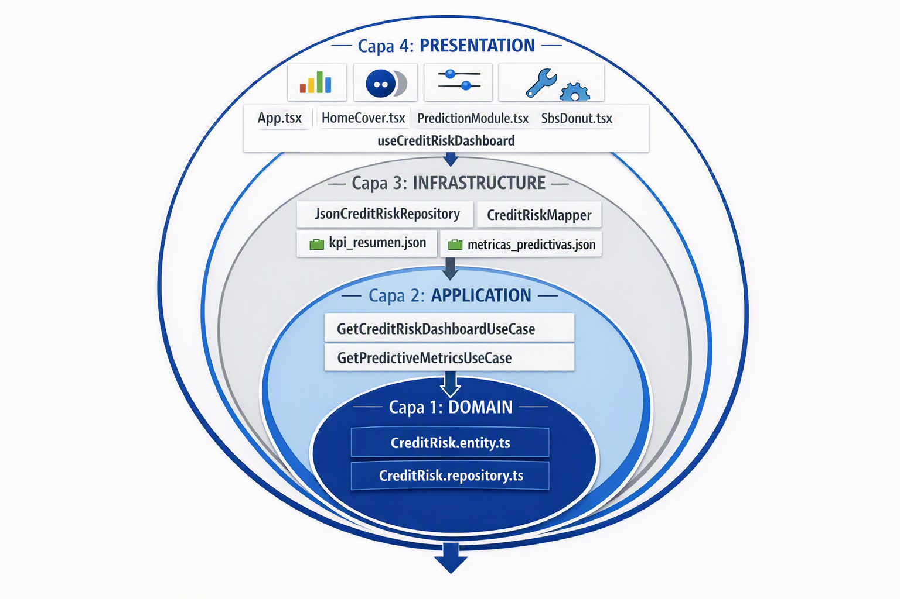

🔒 Nota de confidencialidad: El código fuente del MVP se mantiene en un repositorio privado por contener lógica financiera sensible, reglas de negocio bajo normativas SBS y secretos comerciales de gobernabilidad de modelos. Esta sección expone en detalle la arquitectura de software, el diseño analítico y las decisiones de ingeniería implementadas.


# 📊 Sistema de Evaluación de Riesgo Crediticio y Morosidad (Banca / Fintech)

Un Producto de Datos (*Data Product*) avanzado diseñado para la gestión analítica de carteras financieras de consumo en el mercado peruano. Este sistema implementa una **Arquitectura Limpia (Clean Architecture)** basada en el Diseño Guiado por el Dominio (DDD) en **React + TypeScript**, alimentada por un pipeline de ingeniería de características (*feature engineering*) desarrollado en **Python (Pandas & NumPy)** bajo los lineamientos normativos de la **SBS**.

---

## 🎯 Arquitectura del Sistema (Clean Architecture & DDD)

El frontend ha sido desacoplado al 100% de la infraestructura y de los proveedores de datos externos. La solución se organiza bajo una estructura modular que garantiza la escalabilidad, la mantenibilidad y el cumplimiento estricto de la directiva de compilación `erasableSyntaxOnly` de TypeScript:

```text
src/
├── 🌐 domain/                  # Núcleo puro del negocio financiero (Reglas e Interfaces)
│   ├── entities/              # Entidades tipadas (CamelCase) libres de frameworks
│   └── repositories/          # Contratos abstractos de extracción de datos
├── ⚙️ application/             # Orquestación de Casos de Uso (Business Logic)
│   └── use-cases/             # Casos de uso puros (GetCreditRiskDashboard, GetPredictiveMetrics)
├── 🔌 infrastructure/          # Persistencia, consumo de archivos locales y adaptadores
│   ├── mappers/               # Traductores de datos nativos (Snake_case) a entidades de dominio
│   └── repositories/          # Implementación real de contratos e inyección analítica de factores
└── 🎨 presentation/            # Capa visual e interactiva
    ├── components/            # UI modular con Recharts (KpiCard, RegionRiskChart, SbsDonut)
    ├── hooks/                 # Custom Hooks de aislamiento asíncrono y control de estados
    └── utils/                 # Formateadores con localización estándar es-PE (Soles y porcentajes)
```

### 🗺️ Mapa Visual de Dependencias



---

## 📉 Criterios Analíticos y Adaptación Normativa (SBS Perú)

El dataset crudo global (*Credit Risk Dataset*) fue transformado e hidratado en Python aplicando lógicas financieras y regulatorias locales para simular un portafolio de consumo de la banca local:

* **Regulación de Riesgos SBS:** Se implementó lógica en el pipeline para catalogar de forma predictiva a los solicitantes dentro de las 5 categorías regulatorias de la **Superintendencia de Banca, Seguros y AFP (SBS)**: *Normal, Con Problemas Potenciales (CPP), Deficiente, Dudoso y Pérdida*.
* **Apalancamiento de Ingresos:** Los montos financieros fueron adaptados al Tipo de Cambio local (**PEN - S/**) y se estructuró el ratio de endeudamiento mensual en base a políticas tradicionales que disparan alertas cuando la cuota supera el **30% del ingreso neto mensual**.
* **Mapeo Geo-analítico Multidimensional:** Se estratificaron las muestras asignándoles variables regionales representativas (Lima Metropolitana, Arequipa, La Libertad, Piura, Cusco) para evaluar la concentración de riesgo territorial.

---

## 🤖 Gobernabilidad de Modelos de IA (MLOps)

Para la sección predictiva, el script de Python modeló una **serie temporal sintética (2024 - 2026)** que simula la degradación que sufre un algoritmo de Machine Learning en producción cuando es expuesto al cambio demográfico del mercado de créditos:

1. **Coeficiente de Gini (Discriminación):** Monitorea la capacidad del algoritmo para separar con precisión a los buenos de los malos pagadores. Se visualiza la pérdida paulatina de potencia predictiva año tras año.
2. **PSI (Population Stability Index):** La métrica reina en control de modelos de riesgo. El dashboard evalúa el PSI y genera diagnósticos automatizados: cuando el índice cruza el umbral de **0.25**, la UI emite una **Alerta de Reentrenamiento Urgente** debido a que la población actual ya no se parece a la población de entrenamiento inicial.

---

## 🛠️ Stack Tecnológico Utilizado

* **Ingeniería de Datos:** Python (Pandas, NumPy, JSON serialization).
* **Frontend Core:** React, TypeScript (configuración estricta de borrado de sintaxis).
* **Visualización Científica:** Recharts (Gráficos divergentes/desviación, Donas interactivas con cálculo de *share* de cartera, Tooltips tipados avanzados).
* **Control de Versiones:** Git con metodología simplificada de Pull Requests y nomenclatura bajo estándar **Conventional Commits** (`feat()`, `fix()`, `chore()`).

---

## 💡 Flujo de Navegación Orientado a la Conversión

La aplicación implementa un enrutamiento nativo basado en estado (*State-Based Routing*) optimizado en memoria para Google Chrome a través de referencias estables con `useCallback`:

* **Home/Cover:** Pantalla corporativa institucional que presenta el producto financiero y los accesos rápidos con animaciones fluidas al hacer hover.
* **Dashboard Analítico:** Panel de control de la SBS con filtros interactivos por Tipo de Vivienda que recalculan promedios nacionales, líneas de base de morosidad y titulares de conclusiones analíticas (*Data Storytelling Headlines*) en tiempo real.
* **Módulo Predictivo:** Simulador interactivo individual de *Credit Scoring* mediante barras de desplazamiento continuo y visualizador de estabilidad temporal (Gini / PSI) del modelo de Machine Learning.

---

*Desarrollado de forma integral como pieza de portafolio de alta ingeniería técnica y analítica de datos financieras.*
